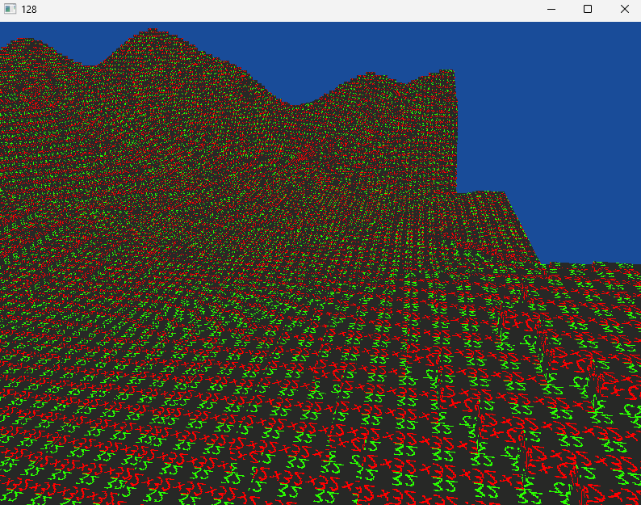
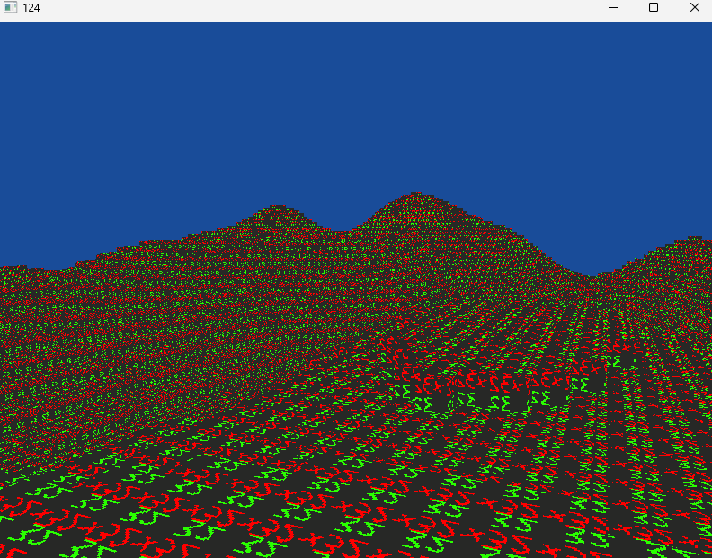
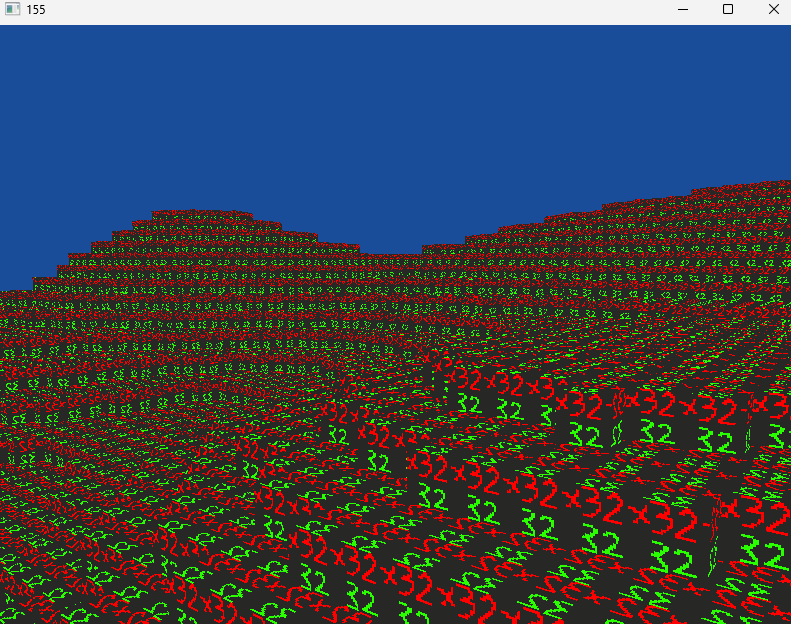
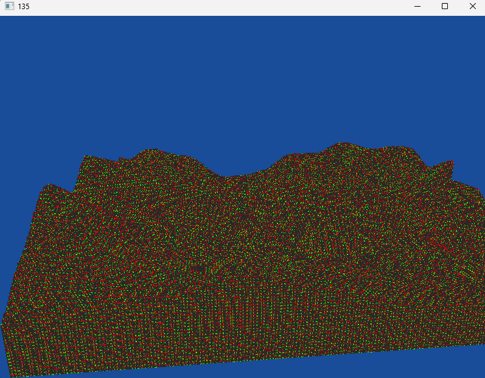

# Solitude-C
 
Abandoned prototype of mine. A voxel game prototype written in C. Uses glfw and opengl for rendering. Has no collisions but at least the textures are animated..

# Controls

- WASD for movement
- Left Shift for flying down
- Space for flying up
- Arrow keys for rotating

# Screenshots
(FPS is low due to vsync being enabled.)

